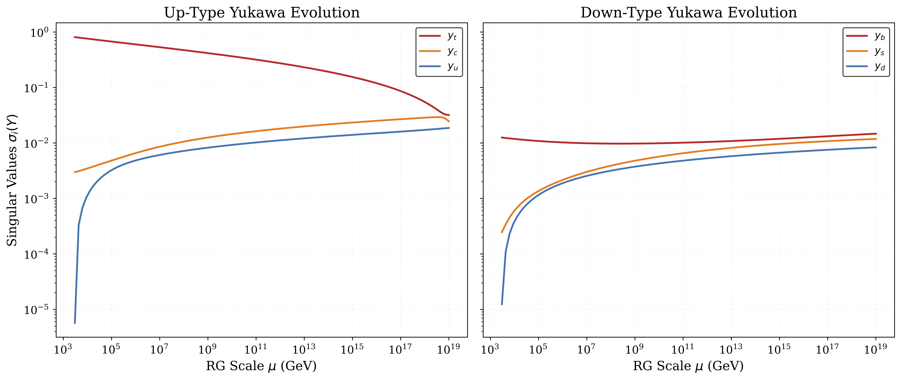
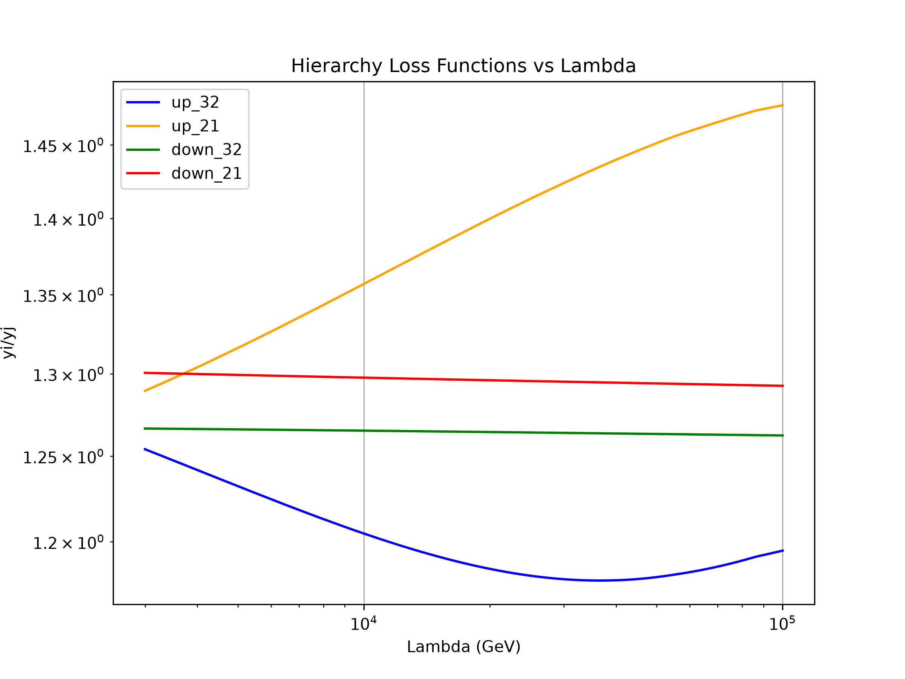
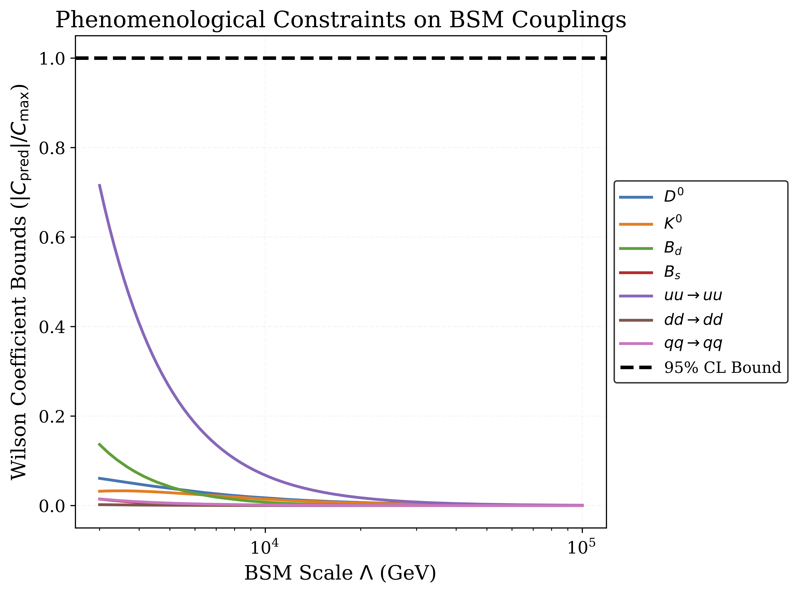

# Machine Learning for the Flavour Puzzle
PyTorch framework that learns Beyond the Standard Model theories that can compress quark yukawa singular values by the Planck scale, while remaining compatible with low energy constraints. 

## Key Results
Given a new physics scale of $\Lambda \in \left[3\text{TeV}, 100\text{TeV}\right]$, the trained neural network outputs complex BSM couplings $\left(\lambda_{q}, \lambda_{u}, \lambda_{d}\right)$ that modify the quark Yukawa matrices up to the Planck scale ($M_{\text{Pl}} = 10^{19} \text{GeV}$)

### Evolution of Yukawa Couplings from $\Lambda =  3 \text{TeV}$
Starting from the 5 order of magnitude Standard Model hierarchy at $3\text{TeV}$, the learned couplings drive the singular values to $\mathcal{O}(1)$ of each other by $M_{\text{Pl}}$:

### Hierarchy Compression
Across the continuous range of BSM scales $\Lambda \in \left[3\text{TeV}, 100\text{TeV}\right]$, the network compresses adjacent generation ratios from $\mathcal{O}(10^{2}-10^{3})$ down to $\mathcal{O}(1)$ by the Planck scale.

 

### Experimental Bounds
Conservatively assuming that the $\left(\lambda_{q}, \lambda_{u}, \lambda_{d}\right)$ couplings can mediate four-quark operators at tree-level, EFT coefficients are computed, and constrained by $95/%$ confidence level bounds taken from (https://arxiv.org/pdf/2402.09503). In all cases the model predicts parameters that are compatible with these bounds.

**Physical Insights (so far):**
* Strong couplings within the up sector $\text{max}\left(\lambda_{u}\right) \sim 3$ preferred.
* Contact operator bounds appear to have a greater intrinsic tension with generating the hierarhcy thatn FCNC bounds do. 

## Background for non-physicists:

The Standard Model of particle physics (SM) describes the interactions between all of the elementary particles the make up the universe. In the SM, the proton and neutron are composed of quarks, of which there are six, three 'up types' (up, Charm, Top), and three 'down types' (down, strange, bottom). One of the deepest open questions within the SM, known as the **flavour puzzle**, is why their masses span five orders of magnitude, from the up quark ($\sim 1\text{MeV}$) to the top quark ($\sim 100 \text{GeV}$). 

The quark masses are govered by the singular values two 3x3 complex 'Yukawa' matrices ($Y_{u}, Y_{d}$). These matrices are not constant, but depend on the energy scale at which the experiment that measures them is done, $\mu$, and therefore the quark masses are predicted to change with energy scale. The differential equations which describe how the yukawa matrices change with energy scale are called the renormalisation group equations (RGEs), and have the form

$\frac{dY_{u}}{dt} = \beta_{u}$ \\
$\frac{dY_{d}}{dt} = \beta_{d}$.

## Assumptions of this work
A few assumptions have been made about the BSM theories considered
* The BSM couplings do not run themselves. This is to make the numerics tractable.
* The 
